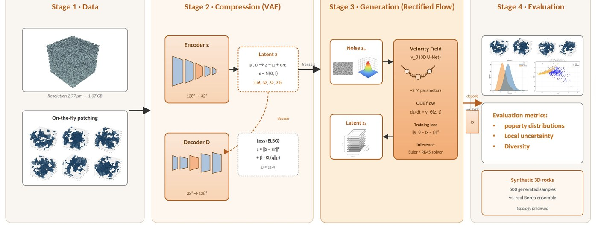
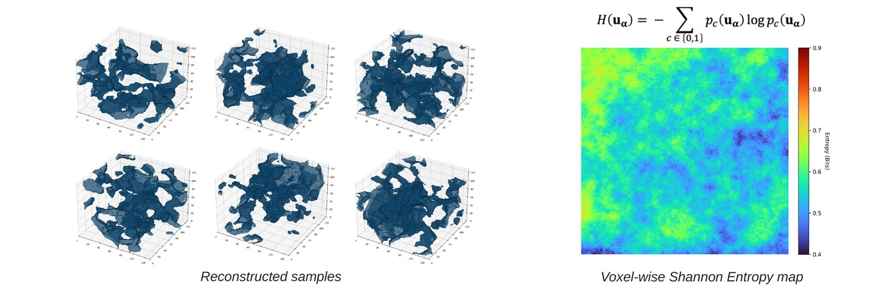
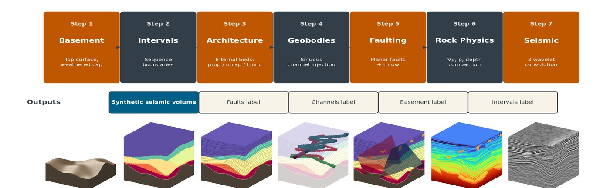
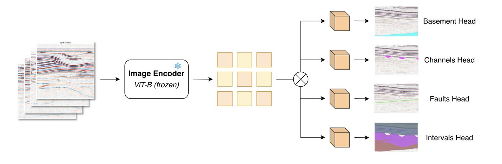

## Dissertation: Multi-Scale Subsurface Characterization: Generative Digital Rocks and a Seismic Foundation Model
*Ph.D. research · UT Austin · co-advised by Michael J. Pyrcz and Maša Prodanović*

Subsurface behavior is controlled at very different scales. At the **pore scale**, rock microstructure governs permeability, capillary pressure, and multiphase flow. At the **basin scale**, reservoir architecture and structure govern migration pathways and well design. Both scales face the same bottleneck: **representative, well-characterized data is scarce.** Micro-CT scans are costly and cover only a small part of a rock's natural heterogeneity. Seismic data is abundant, but interpretation labels are slow, subjective, and usually limited to one task.

My dissertation tests whether **synthetic data can fill that gap at both scales, if it is representative enough.** The approach has three steps: *generate* the data, *characterize* it quantitatively, then *learn and transfer* from it. It is organized into three objectives.

---

## Objective 1: Conditional Latent Rectified Flow for 3D Digital Rocks
*With Runlong Liao, Maša Prodanović, and Michael J. Pyrcz*

Uncertainty quantification needs many statistically representative rock realizations. 3D GANs tend to lose pore connectivity, and full-resolution 3D diffusion is computationally infeasible. I am developing a **two-stage latent generative framework**:

- A **3D variational autoencoder** compresses 128³ binary rock volumes into a 16×32³ latent space, with negligible reconstruction error.
- A **rectified-flow ODE** transports noise to the latent distribution. Training is stable, and there are no diffusion noise schedules to tune.
- It generates **a new 3D Berea sandstone volume in about one second on a single GPU**, cheap enough for large ensembles.

Evaluation goes beyond visual realism: **porosity, specific surface area, and Euler characteristic** distributions; **voxel-wise Shannon entropy** across 500 samples to measure local uncertainty; and **diversity** from PCA of topological networks and SSIM.

**Where it's going:** an eleven-sandstone micro-CT dataset with REV analysis; conditioning on rock type and porosity; generating 256³ and 512³ volumes beyond the training size; evaluating Minkowski functionals, pore sizes, and network permeability; and benchmarking against latent diffusion for accuracy, diversity, speed, and memory.

This builds on my 2D class-conditioned discrete spatial diffusion work (AGU 2025).

---

## Objective 2: SynSeis3D, a Geology-Aware Synthetic Seismic Generator
*With Misael M. Morales (ExxonMobil), Maša Prodanović, and Michael J. Pyrcz*

Seismic interpretation models need **labeled, multi-task training data** with known variability. SynSeis3D is an open procedural engine that builds geology step by step and forward-models the seismic:

- **Procedural geology:** stochastic basement, sequence boundaries resolved by erosion according to stratigraphic laws, internal bedding (proportional, onlap, or truncation), sinuous channels, and 0–5 planar faults with consistent throw.
- **Rock physics and forward modeling:** per-bed velocity and density with depth-dependent compaction, multi-frequency Ricker wavelets, depth attenuation, and correlated noise that mimics migration artifacts.
- **Co-registered labels** for faults, channels, basement, and intervals in every 3D volume, with no manual annotation.
- A **230-volume corpus** with characterized geological and label statistics, and seismic statistics compared with the **F3 (Netherlands)** and **Parihaka (New Zealand)** field surveys.

**Code:** [SynSeis3D on GitHub](https://github.com/zhouqianqianalana/SynSeis3D) · **Paper:** submitted to *Computers & Geosciences*.

---

## Objective 3: A Foundation Model for Seismic Interpretation
*With Misael M. Morales (ExxonMobil), Maša Prodanović, and Michael J. Pyrcz*

Can synthetic data produce **reusable seismic representations that transfer to real surveys?** As a first result, a **frozen SAM ViT-B encoder with a lightweight shared trunk and four task heads** learns faults, channels, basement, and intervals jointly from about 12k synthetic slices. Basement reaches about 0.97 IoU, and the other tasks reach 0.55–0.65.

**Where it's going:**
- Compare encoders (ResNet, ViT, SAM, SegFormer, DINO), random vs. pretrained, plus seismic-specific supervised and self-supervised pretraining.
- Compare single-task vs. multi-task fine-tuning, task weighting, and 2D vs. 3D context.
- Test parameter-efficient adaptation (adapters, LoRA) against full fine-tuning and frozen encoders.
- Test synthetic-to-field transfer to F3 and Parihaka: zero-shot, few-shot, and limited label budgets.

---

## Earlier work

### Predicting 3D Flow Fields in Fractured Media (MS-Net)
*Warm-up project, UT Austin · 2025*

I applied the Multiscale Network for Hierarchical Regression (MS-Net) to predict 3D steady-state velocity fields directly from fracture geometry. The training data were pySimFrac fracture geometries simulated with the lattice-Boltzmann code LBPM. Presented as a poster at IMAGE '25.

### Micro-Proppant Transport in Rough Fractures (CFD–DEM)
*M.Eng. research, China University of Petroleum, Beijing · National Natural Science Foundation of China project · 2022 – 2024*

I was a key Python developer of a fracture-modeling module coupled with CFD–DEM, and studied how conventional and micro-sized proppants migrate and settle in rough fractures. This work led to five papers (*Powder Technology*, ARMA, SPE), talks at InterPore 2023 and 2024 and SIMPAS 2023, and a Chinese invention patent application.

### Proppant Transport by Supercritical CO₂
*B.Eng. thesis, Southwest Petroleum University · 2020 – 2021*

Wrote a program that computes CO₂ properties from the Span–Wagner equation of state, and studied proppant migration in a single-branch fracture model.
